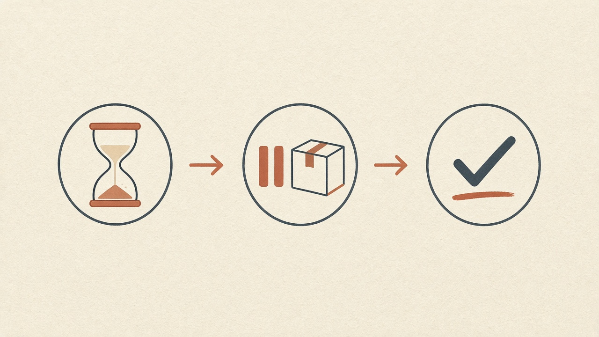
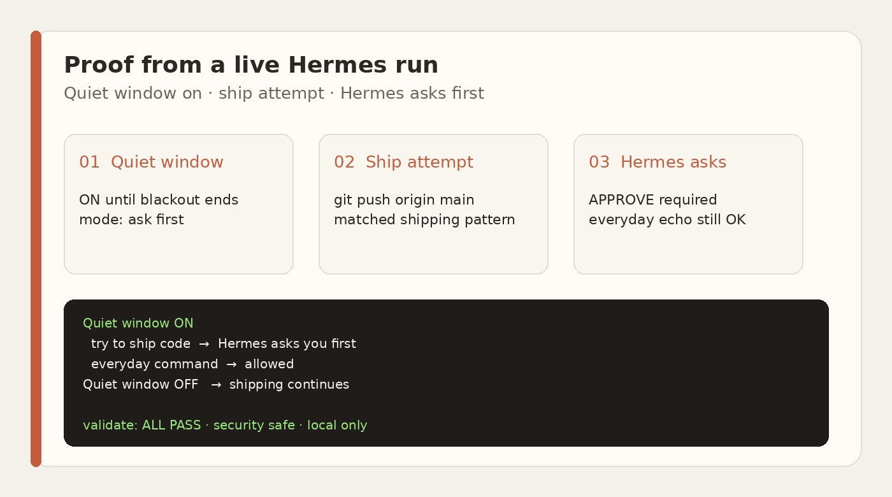

<p align="center">
  
</p>

# ChangeFreeze

**Problem.** An AI helper can ship code while people are using the live product — and break what they see.

**Fix.** You set a quiet window. In that window Hermes **asks you before it ships**. Everyday work still runs. When the window ends, shipping continues.



1. Set the quiet hours.  
2. Hermes asks before shipping in those hours.  
3. Chat and planning keep working.

### Good to know

You end the quiet window, or you let one ship through. The helper can turn a window on, make it longer, or make it stricter. It cannot turn it off, make it shorter, or approve a ship by itself.

You type `/freeze off` to end it. You type `/freeze allow-once` and the command to let one ship through.

Hermes reads the text of the terminal command and the text of a code cell. If a ship command is written there — in one piece, or split into quoted words the way Python's subprocess does — Hermes asks you first. A code cell that says `subprocess.run(["git", "push"])` is one of those.

If the words are built from pieces, encoded, or hidden, this check does not see them. It is not a sealed box.

### Example from a real run

```text
Quiet window ON
  try to ship code  →  Hermes asks you first
  everyday command  →  allowed
Quiet window OFF   →  shipping continues
```



### Try it

```bash
hermes plugins install arults/hermes-changefreeze --enable
```

Pin the reviewed SHA from the [hackathon listing](https://github.com/NousResearch/hermes-agent/pull/149474) when you want a frozen tip.

An earlier install check passed validate and doctor. Unit tests for this revision are in [Evidence](docs/EVIDENCE.md). Run validate and doctor again after you install this revision.

Local only. Nothing leaves your machine.

**[Short demo](https://github.com/arults/hermes-changefreeze/releases/download/v0.1.0-demo/changefreeze-demo.mp4)** · **[X demo](https://x.com/PostcardCrypto/status/2118326708936040613)** · [Hackathon listing](https://github.com/NousResearch/hermes-agent/pull/149474)

MIT · https://github.com/arults/hermes-changefreeze
